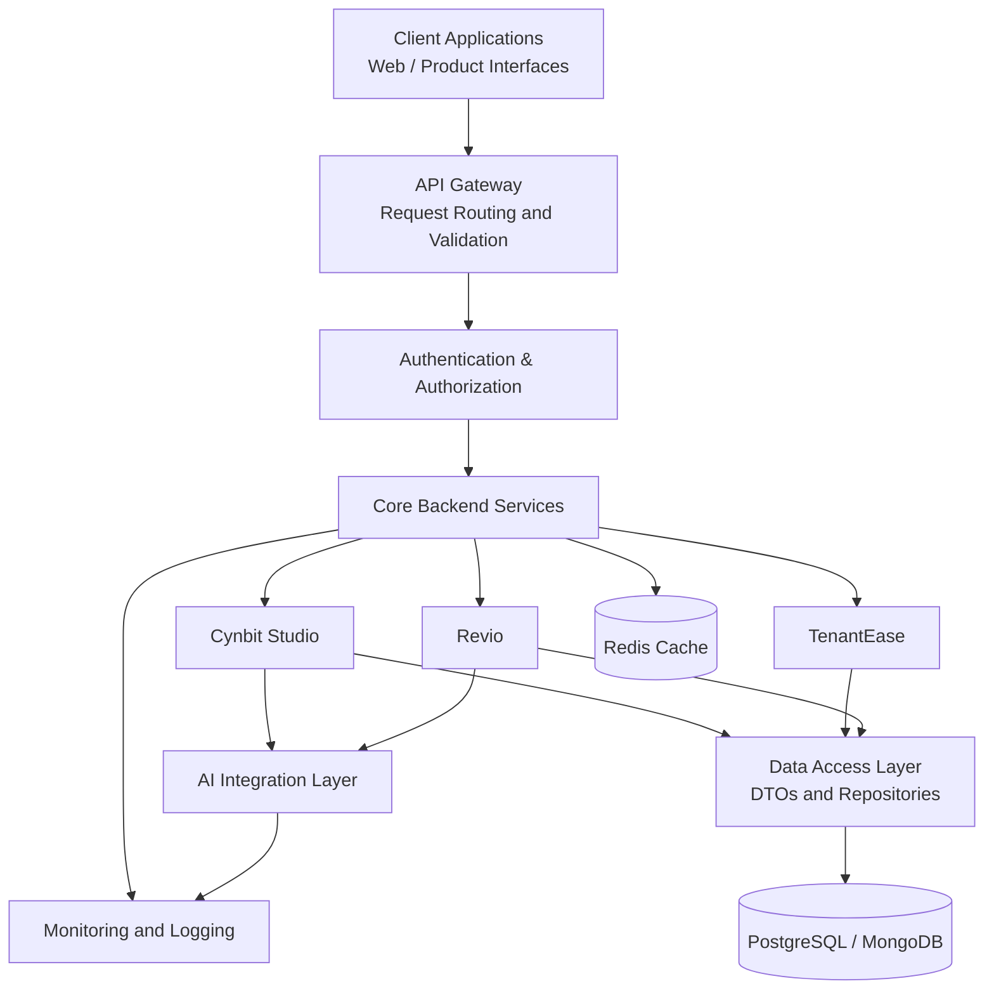

# Cynbit – Backend Technical Audit & Optimization

**Role:** Backend Developer Intern Candidate
**Candidate:** Aditya
**Focus:** Backend Development | API Design | Security | Performance

---

## 1. Project Overview

This project presents an independent backend technical assessment of Cynbit Technologies and its publicly presented product ecosystem.

The objective is to understand the application from a backend developer's perspective, identify potential areas of improvement, and propose practical solutions related to API design, security, data handling, error management, and performance.

The assessment is based on publicly accessible information and non-intrusive website observations. No unauthorized access or security exploitation has been performed.

## 2. Understanding Cynbit's Ecosystem

Cynbit's publicly presented ecosystem includes products and initiatives with different backend requirements.

| Product       | Backend Requirements                                      |
| ------------- | --------------------------------------------------------- |
| Cynbit Studio | User management, coding evaluation and AI integration     |
| TenantEase    | Property, tenant and payment management                   |
| Revio         | Review management, sentiment analysis and automation      |
| BitElevate    | Student records, learning progress and program management |

Understanding these requirements helps identify suitable backend architecture and optimization opportunities.

## 3. Proposed Backend Architecture

Based on the publicly presented product ecosystem, I designed the following logical architecture to demonstrate how different product services could communicate with shared backend components.

**Note:** This is my proposed architecture, not a representation of Cynbit's confirmed internal infrastructure.



### Architecture Components

* **API Gateway:** Handles request routing, validation and rate limiting.
* **Authentication:** Manages user identity and role-based access.
* **Backend Services:** Separates business logic for different products.
* **AI Integration:** Connects AI-powered features with external AI services.
* **Database:** Stores application and business-related data.
* **Redis:** Supports caching and distributed rate limiting.
* **Monitoring:** Tracks application errors and performance.

## 4. Security & Performance Findings

The following are potential risks and improvement opportunities that should be validated through authorized testing.

| ID      | Area             | Potential Concern                     | Recommended Improvement         |
| ------- | ---------------- | ------------------------------------- | ------------------------------- |
| SEC-01  | Rate Limiting    | Repeated requests to public endpoints | Redis-based rate limiting       |
| SEC-02  | Input Validation | Invalid or oversized user input       | Spring Validation               |
| SEC-03  | Authentication   | Improper access permissions           | Spring Security and RBAC        |
| PERF-01 | Caching          | Repeated database operations          | Redis caching                   |
| PERF-02 | API Responses    | Inconsistent response structures      | Standardized DTOs               |
| PERF-03 | Database         | Inefficient database queries          | Indexing and query optimization |

### Key Recommendations

**1. Rate Limiting**

Apply configurable request limits to public APIs to reduce automated spam and unnecessary server workload. Return HTTP 429 when limits are exceeded.

**2. Input Validation**

Use server-side validation for incoming requests. Validate email formats, required fields, input lengths and data types before processing.

**3. Authentication & Authorization**

Implement secure authentication and role-based access control to ensure users can access only permitted resources.

**4. Caching**

Use Redis to reduce repeated database queries for frequently accessed data. Apply suitable expiration and cache invalidation strategies.

**5. API Standardization**

Use DTOs and centralized exception handling to maintain consistent API responses and avoid exposing internal implementation details.

## 5. Proposed Technology Stack

The following technologies are selected for the reference implementation.

| Technology        | Purpose                          |
| ----------------- | -------------------------------- |
| Java 17           | Backend programming              |
| Spring Boot 3     | REST API development             |
| Spring Web        | HTTP request handling            |
| Spring Validation | Input validation                 |
| Spring Security   | Authentication and authorization |
| Spring Data JPA   | Database operations              |
| MySQL             | Database                         |
| Redis             | Caching and rate limiting        |
| Maven             | Dependency management            |
| JUnit 5           | Unit testing                     |

This is a proposed implementation stack, not a claim about Cynbit's existing technology stack.

## 6. Implementation Approach

The proposed improvements can be demonstrated through the following Spring Boot components:

**RateLimitingFilter.java**

* Restricts excessive API requests.
* Tracks requests using client identifiers.
* Returns HTTP 429 when limits are exceeded.

**ApiResponse.java**

* Provides a common API response structure.
* Maintains consistency across endpoints.

Example response:

```json
{
  "success": true,
  "statusCode": 200,
  "message": "Request processed successfully",
  "data": {
    "id": 101
  }
}
```

**GlobalExceptionHandler.java**

* Handles exceptions centrally using `@RestControllerAdvice`.
* Returns meaningful error messages.
* Prevents internal exception details from reaching clients.

**Request Validation**

* Uses annotations such as `@NotBlank`, `@Email` and `@Size`.
* Rejects invalid requests before business logic execution.

## 7. Repository Structure

```text
cynbit-backend-technical-audit/
│
├── README.md
│
├── implementations/
│   └── spring-boot/
│       ├── RateLimitingFilter.java
│       ├── ApiResponse.java
│       └── GlobalExceptionHandler.java
│
├── report/
│   └── Backend_Technical_Audit.md
│
└── screenshots/
    └── website_observations/
```

## 8. Recommended Improvement Roadmap

**Phase 1 – Security**

* Implement API rate limiting.
* Strengthen request validation.
* Review authentication and authorization.
* Configure appropriate security headers.

**Phase 2 – Performance**

* Introduce Redis caching.
* Optimize database queries.
* Use DTOs for API responses.
* Standardize exception handling.

**Phase 3 – Monitoring**

* Integrate Prometheus and Grafana.
* Introduce OpenTelemetry tracing.
* Add automated tests and security checks to CI/CD pipelines.

## 9. Testing Approach

The proposed implementations should be tested in a local development environment.

Testing includes:

* Valid and invalid API requests.
* HTTP response status codes.
* Rate-limiting behaviour.
* Exception handling.
* Cache hit and miss behaviour.
* Backend unit testing using JUnit 5.

No load testing or exploitation against Cynbit's production systems is included.

## 10. Conclusion

This assessment focuses on understanding backend engineering requirements across Cynbit's product ecosystem and identifying opportunities to improve security, performance, and maintainability.

The proposed architecture and Java Spring Boot examples demonstrate practical approaches to API development, request validation, authentication, caching, and exception handling.

The main objective is to translate backend concepts into practical solutions that can contribute to building reliable and scalable applications.

---

**Prepared by:** Aditya 
**Assessment:** Cynbit – Backend Developer Intern
**Project Type:** Independent Technical Assessment

*This report is based on publicly available information and proposed engineering improvements. It does not represent an internal audit or confirmation of Cynbit's actual backend architecture.*
